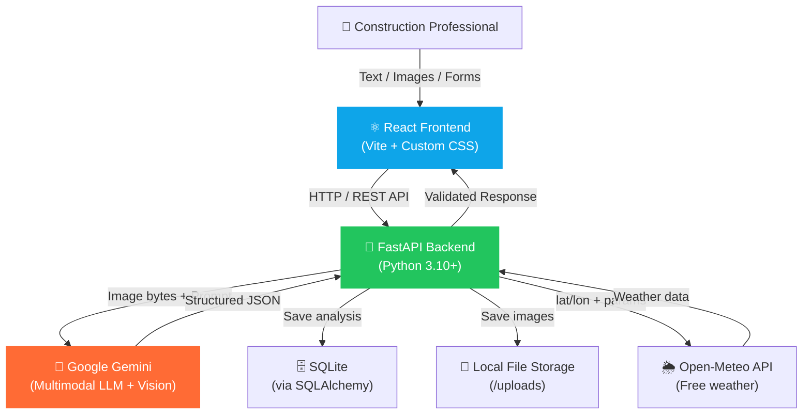

# 🏗️ Multimodal Construction Intelligence Platform

> An AI-powered decision-support system for construction professionals, powered by **Google Gemini** multimodal AI.

[](https://fastapi.tiangolo.com/)
[](https://react.dev/)
[](https://ai.google.dev/)
[](https://python.org/)

---

## 🏛️ Architecture



---

## ✨ Features

| Module | Description |
|--------|-------------|
| 🦺 **Safety Monitoring** | Upload site photos → detect PPE violations, scaffolding hazards, electrical risks |
| 🔍 **Crack Detection** | Classify cracks by type/severity, get repair recommendations |
| 🏠 **Real Estate Valuation** | AI property estimates in INR with market analysis |
| 📅 **Project Planning** | Complete plans with phases, budgets, and risk registers |
| 🌤️ **Daily Site Assistant** | Live weather + AI activity advisories |
| 💬 **Knowledge Chat** | Chat with a construction code expert (IS 456, NBC 2016, etc.) |

---

## 🚀 Quick Start

### Prerequisites
- Python 3.10+
- Node.js 18+
- A Google Gemini API key

### 1. Get a Gemini API Key

1. Visit [Google AI Studio](https://aistudio.google.com/app/apikey)
2. Sign in with your Google account
3. Click **"Create API Key"**
4. Copy the key (starts with `AIza...`)

> 💡 The free tier is sufficient for testing all modules.

---

### 2. Backend Setup

```bash
cd construction-intelligence-platform/backend

# Create virtual environment
python -m venv venv

# Activate (Windows)
venv\Scripts\activate

# Activate (Mac/Linux)
source venv/bin/activate

# Install dependencies
pip install -r requirements.txt

# Configure environment
copy .env.example .env     # Windows
# cp .env.example .env     # Mac/Linux

# Edit .env and add your Gemini API key
# GEMINI_API_KEY=AIza...your_key_here

# Start the server
uvicorn app.main:app --reload --port 8000
```

Backend will be available at: http://localhost:8000
API docs: http://localhost:8000/docs

---

### 3. Frontend Setup

```bash
cd construction-intelligence-platform/frontend

# Install dependencies
npm install

# Start development server
npm run dev
```

Frontend will be available at: http://localhost:5173

---

## 📂 Project Structure

```
construction-intelligence-platform/
├── backend/
│   ├── app/
│   │   ├── main.py              # FastAPI app entry point
│   │   ├── config.py            # Settings (pydantic-settings)
│   │   ├── db.py                # SQLAlchemy async engine
│   │   ├── routers/
│   │   │   ├── safety.py        # POST /api/safety/analyze
│   │   │   ├── cracks.py        # POST /api/cracks/analyze
│   │   │   ├── valuation.py     # POST /api/valuation/estimate
│   │   │   ├── planning.py      # POST /api/planning/generate
│   │   │   ├── assistant.py     # POST /api/assistant/daily + /chat
│   │   │   └── history.py       # GET /api/history
│   │   ├── schemas/
│   │   │   └── schemas.py       # All Pydantic v2 models
│   │   ├── services/
│   │   │   ├── gemini_service.py  # Gemini API wrapper
│   │   │   └── weather_service.py # Open-Meteo API
│   │   ├── prompts/             # Prompt templates
│   │   │   ├── safety_prompt.py
│   │   │   ├── crack_prompt.py
│   │   │   ├── valuation_prompt.py
│   │   │   ├── planning_prompt.py
│   │   │   ├── assistant_prompt.py
│   │   │   └── chat_prompt.py
│   │   └── models/
│   │       └── analysis.py      # SQLAlchemy Analysis model
│   ├── tests/
│   │   └── test_endpoints.py    # pytest tests
│   ├── requirements.txt
│   ├── pytest.ini
│   └── .env.example
├── frontend/
│   ├── src/
│   │   ├── api/client.js        # Axios API client
│   │   ├── components/
│   │   │   ├── ImageUploader.jsx
│   │   │   ├── RiskBadge.jsx
│   │   │   ├── Loader.jsx
│   │   │   └── ResultCard.jsx
│   │   ├── pages/
│   │   │   ├── Dashboard.jsx
│   │   │   ├── Safety.jsx
│   │   │   ├── Cracks.jsx
│   │   │   ├── Valuation.jsx
│   │   │   ├── Planning.jsx
│   │   │   ├── DailyAssistant.jsx
│   │   │   ├── Chat.jsx
│   │   │   └── History.jsx
│   │   ├── App.jsx              # Routes + Sidebar
│   │   ├── index.css            # Global design system
│   │   └── main.jsx
│   └── package.json
├── sample_data/
│   └── sample_requests.json
├── DEMO_SCRIPT.md
├── .gitignore
└── README.md
```

---

## 🔌 API Reference

### Health Check
```http
GET /api/health
```

### Safety Monitoring
```http
POST /api/safety/analyze
Content-Type: multipart/form-data

image: <file>       # JPG/PNG/WebP, max 5MB
notes: string       # optional
```

**Response:**
```json
{
  "risk_level": "HIGH",
  "overall_score": 45,
  "violations": [
    {"category": "PPE", "description": "No helmet", "location_in_image": "center"}
  ],
  "missing_ppe": ["helmet", "vest"],
  "hazards_detected": ["unsecured scaffold edge"],
  "corrective_actions": ["Provide helmets immediately"],
  "immediate_actions": ["Stop height work"],
  "summary": "High risk site conditions detected."
}
```

### Crack Detection
```http
POST /api/cracks/analyze
Content-Type: multipart/form-data

image: <file>
notes: string
```

### Real Estate Valuation
```http
POST /api/valuation/estimate
Content-Type: application/json

{
  "location": "Bandra West, Mumbai",
  "area_sqft": 1200,
  "property_type": "apartment",
  "age_years": 8,
  "bedrooms": 2,
  "bathrooms": 2,
  "amenities": ["Parking", "Gym"],
  "condition": "GOOD"
}
```

### Project Planning
```http
POST /api/planning/generate
Content-Type: application/json

{
  "project_type": "residential",
  "size_sqft": 3000,
  "budget_inr": 7500000,
  "deadline_months": 18,
  "workforce_count": 30
}
```

### Daily Site Advisory
```http
POST /api/assistant/daily
Content-Type: application/json

{
  "location": "Andheri East, Mumbai",
  "activities": ["Concrete pouring", "Scaffolding erection"],
  "workforce_count": 45
}
```

### Knowledge Chat
```http
POST /api/assistant/chat
Content-Type: application/json

{
  "message": "What is the minimum concrete cover for slabs per IS 456?",
  "history": [
    {"role": "user", "content": "previous message"},
    {"role": "assistant", "content": "previous reply"}
  ]
}
```

### History
```http
GET /api/history?module=safety&limit=50
DELETE /api/history/{id}
DELETE /api/history
```

### Settings & AI Key Configuration
```http
GET /api/settings
POST /api/settings/apikey
POST /api/settings/test-key
```

### Static File Serving
```http
GET /uploads/{filename}
```


---

## 🧪 Running Tests

```bash
cd backend
pip install -r requirements.txt

# Run all tests
pytest tests/ -v

# Run specific test class
pytest tests/test_endpoints.py::TestSchemas -v
pytest tests/test_endpoints.py::TestSafetyEndpoint -v
```

Tests include:
- Schema validation (valid/invalid inputs)
- Health endpoint
- Safety endpoint with mocked Gemini
- Valuation endpoint with mocked Gemini

---

## 🌍 Environment Variables

| Variable | Default | Description |
|----------|---------|-------------|
| `GEMINI_API_KEY` | — | **Required** — Your Google Gemini API key |
| `DATABASE_URL` | `sqlite+aiosqlite:///./construction.db` | Database URL |
| `UPLOADS_DIR` | `./uploads` | Directory for uploaded images |
| `MAX_UPLOAD_SIZE_MB` | `5` | Maximum upload size in MB |
| `ALLOWED_ORIGINS` | `http://localhost:5173` | CORS allowed origins |
| `GEMINI_MODEL` | `gemini-2.0-flash` | Gemini model to use |

---

## 🔒 Security Notes

- Never commit `.env` to version control
- The `.gitignore` excludes `.env`, `uploads/`, `venv/`, `node_modules/`
- Image uploads are validated for type and size before processing
- Gemini responses are validated against Pydantic schemas
- CORS is restricted to configured origins

---

## 📊 AI Design Principles

1. **Structured JSON output**: All Gemini calls use `response_mime_type="application/json"`
2. **Retry logic**: Failed validation → retry once → structured error fallback
3. **Prompt engineering**: Every prompt has role → context → task → constraints → schema → example
4. **Pydantic validation**: All AI output is validated before reaching the frontend
5. **No hardcoded secrets**: API key loaded from `.env`

---

## 🛠️ Tech Stack

| Layer | Technology |
|-------|-----------|
| Frontend | React 18, Vite, Custom CSS, Axios |
| Backend | Python 3.10+, FastAPI 0.115, Uvicorn |
| AI | Google Gemini (`google-genai` SDK) |
| Database | SQLite via SQLAlchemy 2.0 (async) |
| Weather | Open-Meteo API (free, no key needed) |
| Testing | pytest, pytest-asyncio, httpx |

---

## 📝 License

MIT License — Free for educational and commercial use.

---

*Built with ❤️ for construction professionals. Powered by Google Gemini AI.*
